# Using Portfolia

This is the product guide: what each screen is for, and the order to do things in. Screenshots were taken on 26 October 2026 while signed in as the demo user. Yahoo prices move, so your numbers will not match the pictures. Spinners on the first load are normal; the app is fetching history.

The API and the calculation rules are documented next to the code. Start at [portfolio/CLAUDE.md](../portfolio/CLAUDE.md) if you are changing the software. This guide is about using it.

## Open the app

Open <https://ubuntu-1.tail13e229.ts.net:3443> from any device on the tailnet (on the server itself, <http://localhost:3000> also works). You stay signed in across reloads through a secure cookie, which browsers only keep over HTTPS or localhost: on plain `http://100.104.10.24:3000` a reload signs you out. The API is only on the server, at <http://127.0.0.1:8000/docs>.

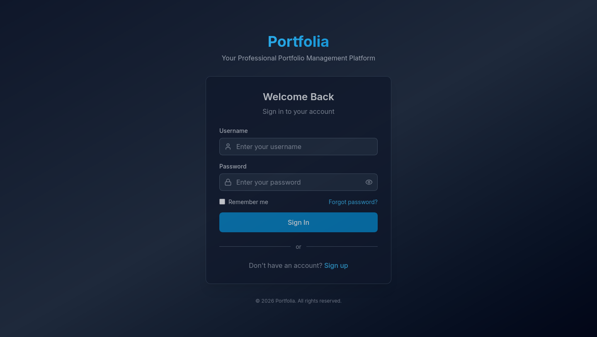

### Demo user

| | |
|---|---|
| Username | `demo` |
| Password | `DemoApp!234` |
| Email | `demo@example.com` |

The account is already verified. Its trades are synthetic: about three years of buys, sells, and dividends in real US listings, with real Yahoo prices, splits, and dividends. It is not someone's brokerage account.

After you sign in you have:

| Portfolio | Currency | What it is |
|---|---|---|
| Demo — Day trading (dense history) | USD | The busy book. 12 holdings, hundreds of trades. This is the one in the portfolio screenshots. |
| Demo — Weekly rhythm | USD | A trade about once a week. |
| Demo — Monthly rhythm | USD | A trade about once a month. |
| Demo — Europe | EUR | Empty. Use it for the sample import below. |

There is also **Demo watchlist** (AAPL, GOOGL, MSFT, SPY) and a saved indicator set named **Demo analysis**.

The password is the default baked into the seed script. Change it if the UI is reachable by anyone but you. Re-running the seed **without** thinking adds a second copy of the three USD portfolios. `--reset` deletes that user first, including Demo — Europe:

```bash
docker exec portfolio-api-1 python scripts/seed_demo_application.py \
  --base-url http://localhost:8000 \
  --email demo@example.com --username demo --password 'DemoApp!234' --reset
```

Do not point `--reset` at any other username.

### Your own account

**Sign up** asks for a username, email, and password. Portfolia sends a verification link through Brevo. Many actions wait until the address is verified. **Forgot password** emails a reset link; the reset token lives in Redis for a short time.

There is no profile page yet. Changing your password, your name, or deleting the account has an API and no screen.

## Dashboard

The home page after sign-in.

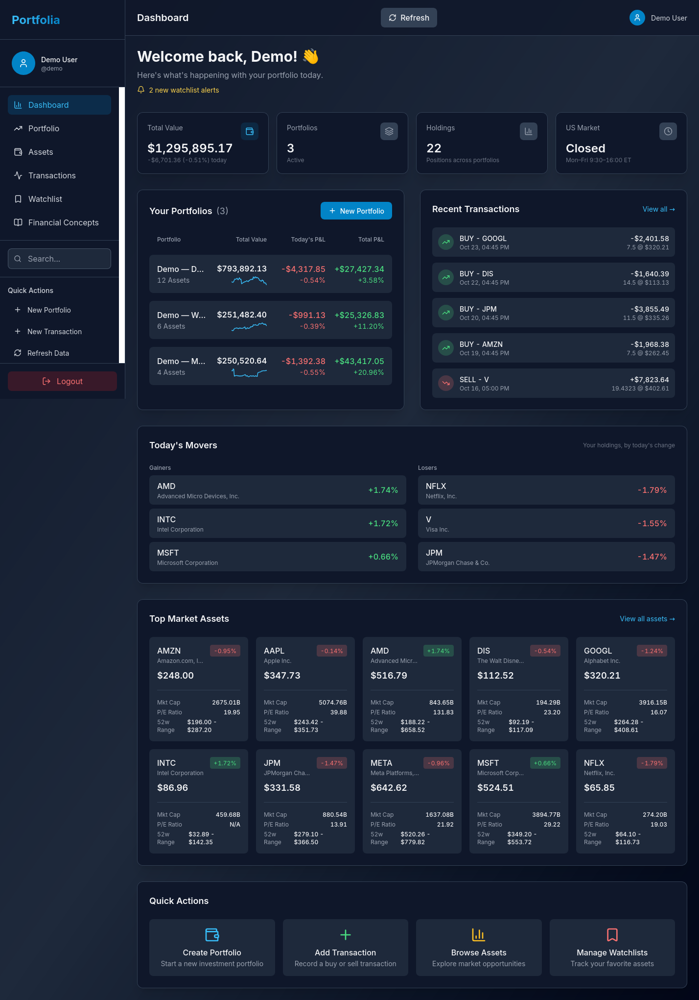

Read it top to bottom:

1. **Total Value** is the sum of live holdings, in the portfolio's currency. A USD listing inside an EUR portfolio is converted at Yahoo's daily rate. If you have separate portfolios in different currencies, you see one amount per currency: those portfolios are not added together.
2. **Portfolios** and **Holdings** are counts. **US Market** is open or closed on the New York clock. It does not know US holidays.
3. The yellow alert line jumps to the watchlist. The demo user has two alerts that were already true when the account was created.
4. **Your Portfolios** is one row per book: value, today's P&L, total P&L versus cost, and a three-month sparkline. Open a row to go to that portfolio.
5. **Recent Transactions** is the latest five. Buys are money out (negative). Sells and dividends are money in.
6. **Today's Movers** is the best and worst held symbols by today's percent. The browser only sorts; the server sends the holdings.
7. **Top Market Assets** is your own symbols with quote detail, not a market-wide ranking. The page asks for a market-cap sort that the server ignores.
8. **Quick Actions** create a portfolio, record a trade, open assets, or open the watchlist.

**Refresh** reloads every card. The value cards can sit on "—" for several seconds while prices load.

## Portfolios

**Portfolio** in the sidebar. The dropdown in the page, and the same dropdown in the sidebar, pick which book you are looking at. Five icons under the dropdown switch the view: Overview, Holdings Detail, Portfolio Assets, Performance Chart, Performance Metrics.

### Overview

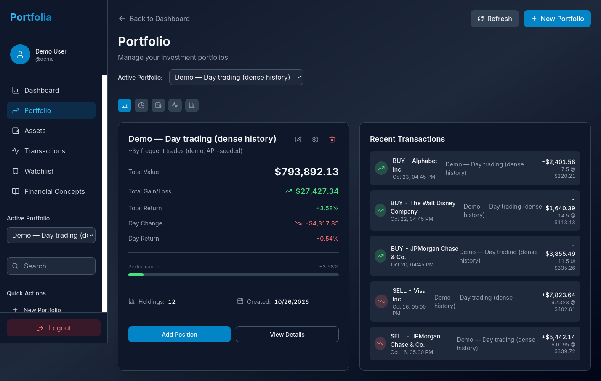

The card is the live summary of the selected book:

- **Total Value** — priced holdings.
- **Total Gain/Loss** and **Total Return** — unrealized gain versus FIFO cost. This is not the time-weighted return. Performance Metrics is where TWR lives.
- **Day Change** — today's P&L in money and percent.
- **Holdings** — how many positions, including names you have fully sold if they still have realized P&L.

**Add Position** starts a transaction. **View Details** opens Holdings Detail. **Refresh** rebuilds every position from the transactions (so a new split shows up) and fetches prices again. The pencil edits the portfolio's name and description. Delete is soft: the book is hidden, not wiped, unless you use the hard-delete API.

Recent transactions on the right are only this portfolio's.

### Holdings Detail

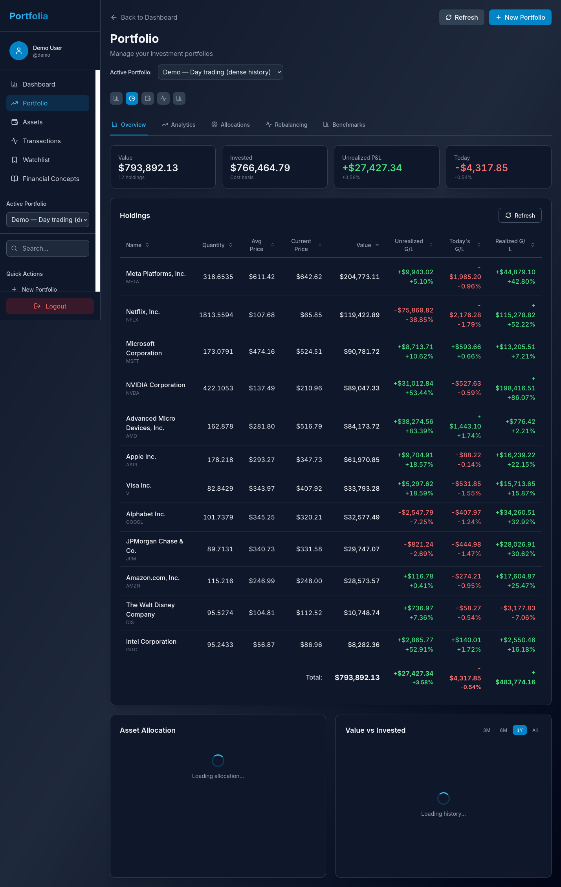

The strip across the top is the same summary as the overview card: value, cost, unrealized P&L, today. The second row is the tax view: realized P&L on sales before tax (Trade Republic shows the same per-sale gains), dividends before tax, taxes paid (withheld on sales and dividends, minus the refunds Trade Republic books when a loss is offset), and what is left after tax. Tax on cash interest is not included.

The table is one row per position. Quantity is in today's shares (a past split does not leave you with the old count). Avg Price is the FIFO cost per share. Value is blank when Yahoo has no price, and that row is excluded from the total rather than priced at cost. The footer matches the strip.

Fully sold names stay in the table so the realized column still has somewhere to live.

Under the table, **Asset Allocation** is a donut of current weights and **Value vs Invested** is the same series as the performance chart. Both can keep spinning after the table has appeared; they wait on history.

The tabs on this view:

| Tab | What it does |
|---|---|
| Overview | The holdings table above. |
| Analytics | Risk for the period you pick. See the next section. |
| Allocations | Target weights. Drift turns red when it passes the threshold (5% if you did not set one). |
| Rebalancing | How many shares to buy or sell to reach those targets, with a rough commission. |
| Benchmarks | Names you stored as benchmarks. The comparison itself is not on this tab. |

### Analytics

Open Holdings Detail, then **Analytics**.

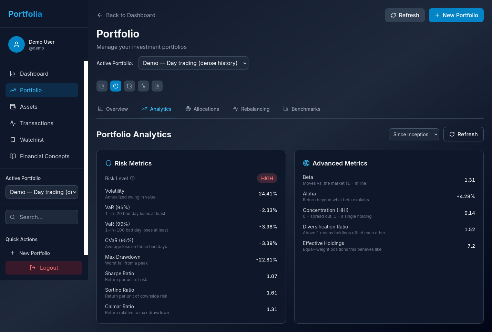

**Risk Metrics** are computed from the portfolio's own daily returns: volatility, VaR, CVaR, max drawdown, Sharpe, Sortino, Calmar, and a High / Medium / Low label. The info icon on the risk level explains the label in a dialog.

**Advanced Metrics** compare the book with `^GSPC` (the S&P 500 price index, not a total-return index) and score concentration: beta, alpha, the Herfindahl index, a diversification ratio, and how many equal positions the book behaves like. The first open of this tab can take about twenty seconds.

The period dropdown defaults to since inception. A shorter window changes the risk numbers. It does not change the holdings table.

### Allocations and rebalancing

**Allocations** is where you say what you meant to hold. Each target is a percent of the portfolio, with an optional band and a rebalance threshold. The demo portfolios were seeded with equal weights.

**Analysis** shows current weight, target, and drift. A name you targeted but do not hold is included at 0%. A holding with no price is skipped.

**Rebalancing** turns the drift into a share count: "sell this many shares at the current price." The commission guess is 0.1%. Tax impact is not estimated. Nothing is sent to a broker; you still place the trade yourself and record it.

### Performance Chart

The fourth icon.

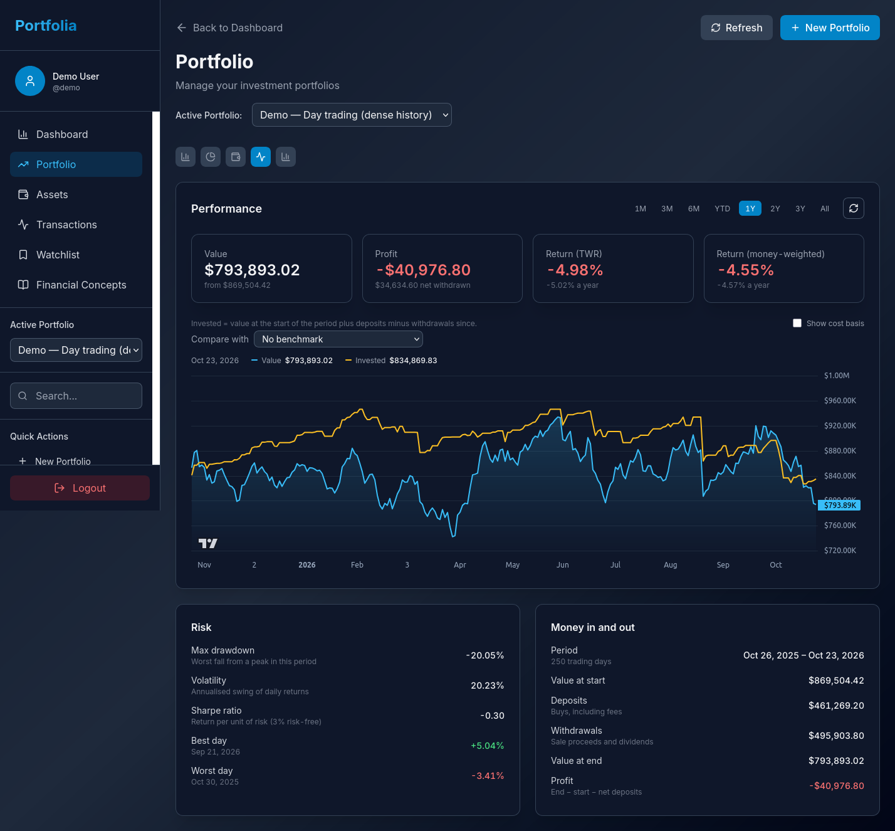

Pick the window with the pills: 1M, 3M, 6M, YTD, 1Y, 2Y, 3Y, All. The demo shot is **1Y**, which is why it shows a loss even though the since-inception TWR on the next screen is large. The window is the whole point of this page.

The four tiles:

- **Value** now, and the value at the start of the window.
- **Profit** — end value, minus start value, minus net deposits. This is the money you made, not a percent.
- **Return (TWR)** — time-weighted. Deposits do not count as a gain.
- **Return (money-weighted)** — MWR for this window. It does count when you added or removed cash.

The chart's blue line is value. The yellow line is invested (value at the start of the window, plus later deposits, minus withdrawals). **Show cost basis** adds the FIFO cost line.

**Compare with** lists total-return benchmarks for the portfolio's currency (for USD, the S&P 500 total-return index; for EUR, accumulating ETFs such as VWCE and EUNL) and also accepts any Yahoo ticker. The extra line is a shadow portfolio: your deposits buy the benchmark, your withdrawals sell it. A card underneath shows you, the shadow, and the difference in value, profit, TWR, and MWR. A ticker quoted in another currency is converted into the portfolio currency first.

**Risk** on this page is for the same window: max drawdown, volatility, Sharpe (3% risk-free), best day, worst day.

**Money in and out** is the cash ledger for the window: deposits (buys, including fees), withdrawals (sale proceeds and dividends), and the profit identity `end − start − net deposits`.

A held symbol with no price in the window fails the chart instead of drawing a hole. The page shows that error rather than a made-up line.

### Performance Metrics

The fifth icon.

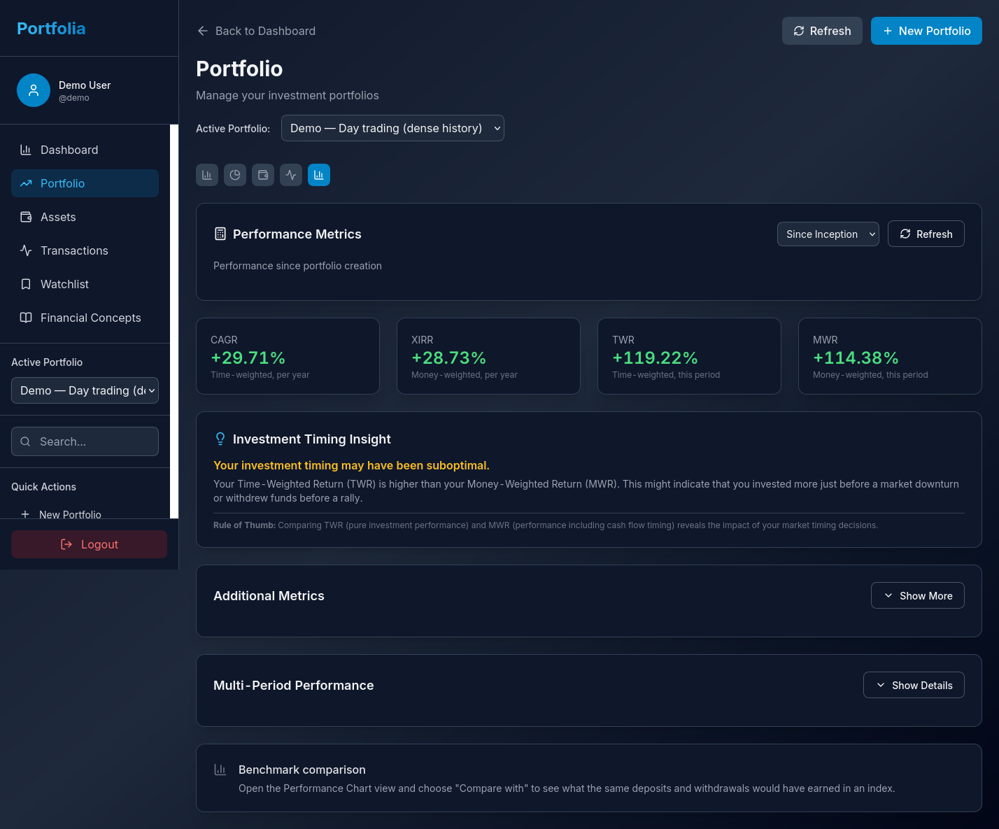

Same engine, laid out as period tiles.

- **CAGR** is the annualized time-weighted return. Under one year it is just the period TWR, not an annualized figure.
- **XIRR** is the annual money-weighted return.
- **TWR** and **MWR** are the period returns, not per-year.

The timing note compares TWR with MWR. TWR above MWR means, roughly, that cash went in before a weak patch or left before a strong one. It is a hint, not a judgment of the whole account.

**Multi-Period Performance** (Show Details) puts several windows side by side from one calculation. **Additional Metrics** opens the rest of the risk block.

The benchmark paragraph at the bottom points back at **Compare with**. It does not draw the comparison itself.

### Portfolio Assets

The third icon. Cards for the symbols in this portfolio, with sector, market cap, and the day's move filled in from the asset list. Useful when you want the instrument, not the position.

### Create a portfolio

**New Portfolio** asks for a name, a description, and a currency. Pick the currency of the listings you will hold. You cannot mix currencies in one book, and you cannot change your mind later without the app rejecting the trades.

## Transactions

Every position is derived from transactions. Editing a holding's quantity by hand is the wrong tool; add or edit the trade.

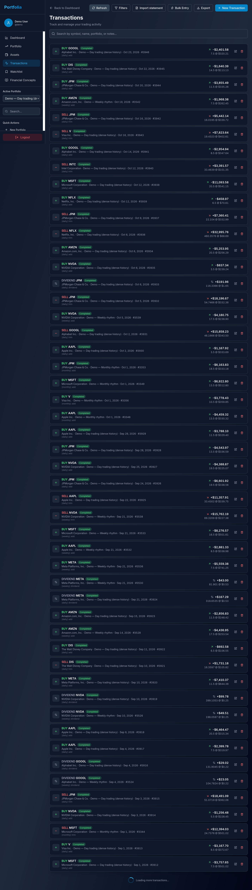

The page loads the book's history and filters it in the browser (portfolio, type, dates, the search box in the sidebar).

**New Transaction**

1. Choose the portfolio and the symbol. Symbol search hits Yahoo. If you already track the symbol, pick it from your assets.
2. Choose buy, sell, or dividend.
3. Enter quantity, price, fees, and the date. The form can fill the money amount from quantity × price. The server recomputes the stored total anyway: buys are quantity × price + fees + taxes, sells are quantity × price − fees − taxes.
4. Save. The position and the charts update from that write.

A sell larger than the position is rejected. Only **completed** transactions count. Pending, cancelled, and failed rows are stored and ignored by the maths.

Dividends use the cash amount. Price and quantity can be zero. Tax you type is stored, but it is not yet subtracted from the dividend cash on a hand-entered row.

Other types (split, transfer, fee) can be stored and are ignored by the engine. Splits come from Yahoo, not from a split transaction.

**Bulk Entry** is the same create, many rows at once, in one database transaction.

**Export** previews a PDF of the filtered transactions and downloads it. Amounts in the file are still printed with a `$`.

**Edit** and **delete** are on the row. Deleting a trade rebuilds the position. There is no undo.

### Import a broker file

**Import statement** accepts three providers:

| In the dialog | File | Notes |
|---|---|---|
| Trade Republic | PDF statement | Trades, savings plans, and dividends. Cash rows are shown and not imported. |
| Trade Republic (pytr CSV) | `pytr export_transactions` | The full history, including fees and withholding tax. |
| Portfolia | A PDF this app exported | Round-trip of our own report. |

Use a portfolio in the **same currency as the file**. Trade Republic files are EUR. The demo USD books will refuse the sample file. **Demo — Europe** exists for this.

Sample file: [examples/demo_trade_republic.csv](examples/demo_trade_republic.csv). It is synthetic, built from real Frankfurt closes so the ISIN matcher can check each fill against that day's range. It contains:

- a monthly €200 VWCE savings plan and a monthly €150 EUNL savings plan from 2024
- SAP and Allianz buys, one SAP sell, and dividends with German withholding tax
- a €5,000 deposit and an interest payment, which the importer lists and skips (no cash account)

Steps:

1. Transactions → **Import statement**.
2. Choose **Trade Republic (pytr CSV)** and the sample file. Parsing does not write anything.
3. The instrument panel shows one line per ISIN. Status is one of: already your asset, matched, please check, or no match. A listing in the wrong currency is marked in red and blocks save until you change it or leave it out.
4. Pick **Demo — Europe**. Rows already in that portfolio are badged **imported**, dimmed, and left out. The first import of the sample imports all of them.
5. Save. The whole batch is one transaction: either every new row is stored and the positions rebuild, or nothing is stored. A toast says how many rows were skipped as duplicates.

Importing the same file again imports nothing new. That is the re-import check: each row has a key, and a row imported before keys existed is recognized by date, type, ISIN, quantity, and cash amount.

What the Trade Republic parsers skip, and why:

- Deposits, withdrawals, card payments, interest, and account-level tax — no cash balance to attach them to
- Splits — Yahoo's prices are already split-adjusted; importing the split as well would double it
- Swaps, spin-offs, and security transfers — not modeled yet

A Trade Republic PDF does not print withholding tax per dividend, so those dividend rows store tax as zero. The pytr CSV does include it, and the sample file uses that path.

Knock-out certificates and warrants often have no Yahoo price. Leave those ISINs out or type a ticker yourself.

### Keep a portfolio in sync with Trade Republic

On a server where Trade Republic sync is set up for your account, create or edit an EUR portfolio and tick **Keep in sync with Trade Republic**. A bar above the portfolio then shows the last import.

- **Fetch from Trade Republic** downloads your latest transactions and imports them into every synced portfolio. The first time, or when the session has ended, it asks for your phone number and PIN. Then confirm the login in the Trade Republic app, or type the code from your authenticator app. Your PIN is not stored. The download runs in the background, and the bar says when it is done and how many transactions were new.
- **Import file** re-reads the last downloaded file without contacting Trade Republic. The server also does this every 15 minutes when the file changes.
- Logging in here can end a Trade Republic session in another app on the same server (Bachat), and the other way round. That app then asks you to log in again.
- Knock-outs and other securities Yahoo has no prices for are valued at their own last trade. Under **Details** you can give one a Yahoo ticker instead.

## Watchlists

For symbols you do not hold, or hold and still want a price alarm on.

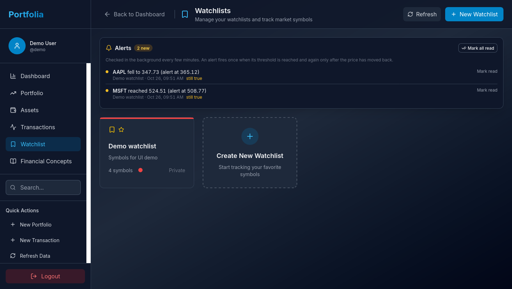

**New Watchlist** creates a named list. Lists can be marked public. **Public watchlists → Browse**, under your own lists, shows other people's public lists; opening one shows its symbols read only.

Open **Demo watchlist**:

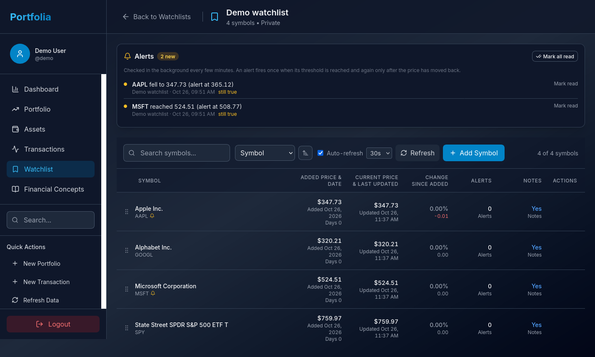

**Add Symbol** searches Yahoo and stores the price at that moment as the "added" price. The table then shows the latest price, the change since you added it, notes, and a bell when an alert is active.

**Edit** a row to set:

- a high price (fires when the price is at or above it)
- a low price (at or below)
- a percent move since the added price
- alerts on or off
- a note
- a rating (1 to 5 stars), tags and an investment thesis. Stars and tags show under the name; the thesis shows when you hover the name.

The demo alerts were set around the price on the day the account was created, so the panel has something to show. AAPL's low is above the live price, and MSFT's high is below it. They are examples, not recommendations. **Mark read** acknowledges an alert. It fires again only after the condition stops being true and then becomes true again, or you change the threshold.

The worker checks about every 15 minutes (`WORKER_INTERVAL_SECONDS`, default 900). **Refresh** on the page fetches prices immediately but the alert decision still belongs to the worker. Nothing is emailed. The dashboard link and the bell are the whole notification.

Prices are shown in each symbol's quote currency. A London listing quoted in pence shows as, for example, `152.40 GBp`. Rows added before 2026-10-29 get their currency on the worker's next pass.

**Price history** in a row's menu shows the daily price the worker has recorded since you added it, with the low and high.

Reorder by dragging.

## Assets and indicators

**Assets** is your symbol book, shared by transactions, portfolios, and watchlists.

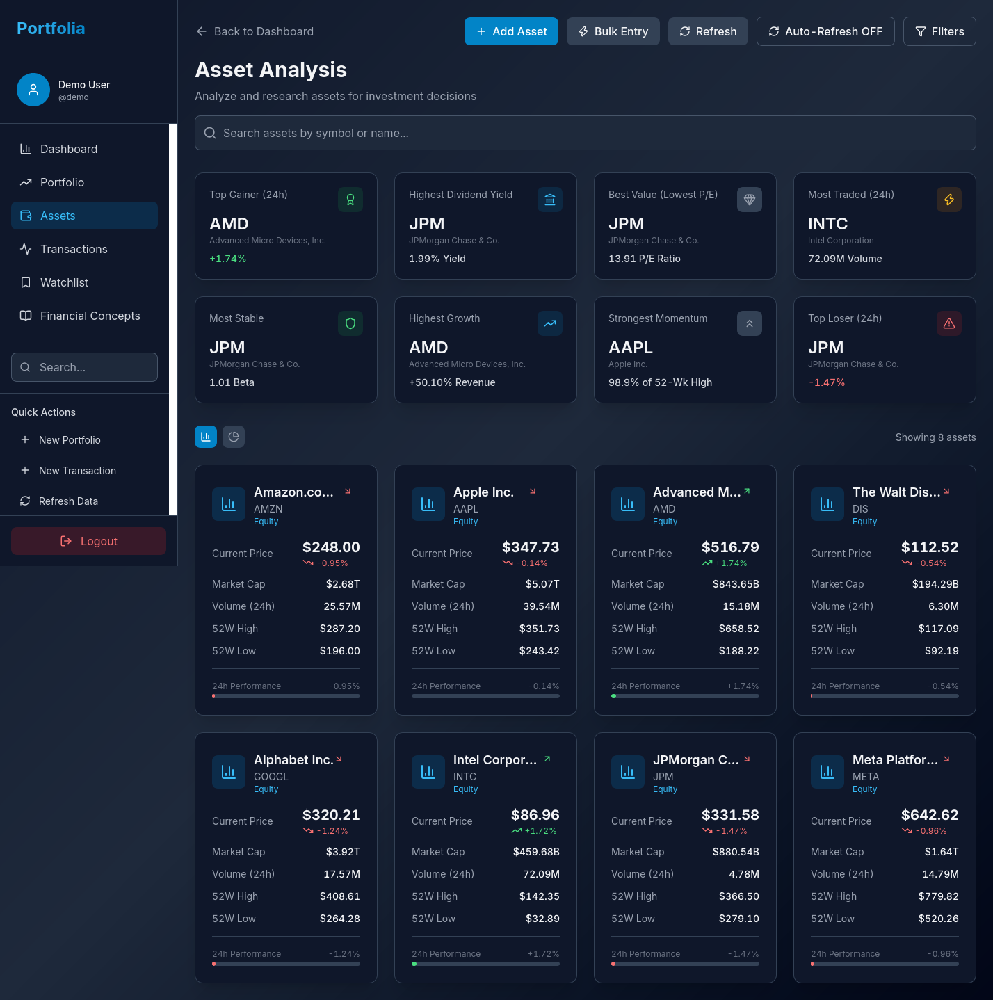

**Add Asset** looks the ticker up on Yahoo and saves it. **Bulk Entry** takes several tickers. The eight tiles (top gainer, dividend, P/E, volume, and so on) are computed from the rows currently loaded, not from the whole market. Treat **Highest Growth** with suspicion; its percent scale is not confirmed.

Search and column sorting on this page do not reach the server. Type filtering does. The "of N" count stays empty for the same reason.

Open a symbol for a price chart. The chart starts with RSI and MACD over 30 days, with extra history loaded so the averages are warmed up. **Manage Configurations** saves a named set of indicators and their parameters. Applying a set recalculates the chart from that set. Ticking an indicator by hand leaves the saved set. A private set is visible only to you.

Indicators, all checked against the `ta` library:

| Group | Indicators |
|---|---|
| Momentum | RSI, ROC, Stochastic RSI, Stochastic oscillator |
| Trend | MACD, ADX, Aroon, Parabolic SAR, CCI |
| Volatility | Bollinger Bands, ATR, Keltner Channels |
| Volume | MFI, VPT, VWAP, OBV, Force Index |

The MACD and GFS strategy code in the repository is tests only. There is no strategy screen and no backtest.

## Financial Concepts

A glossary, with no API behind it. Search, filter by category, and open a card. The definitions match the engine: MWR is the period return, XIRR is the annual one, TWR ignores the size of deposits.

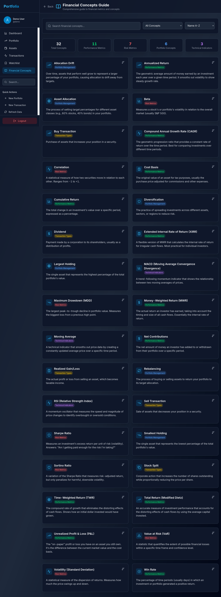

If a card and a number on a portfolio ever disagree, the portfolio is right and the card should be updated.

## Day to day

A normal loop:

1. Dashboard, for today's P&L and anything the watchlist raised.
2. Record trades the same day you place them. Fees go in the fee field, not inside the price, if you want FIFO cost to match the broker.
3. After a statement arrives, import it into the matching-currency portfolio. Importing twice is safe.
4. When a position looks wrong, open the transactions for that symbol before editing anything. The position is a cache.
5. Use Performance Chart, not the portfolio card, when the question is "how did this window do relative to the cash I added?"
6. Use Compare with when the question is "what if that cash had gone into the index?"

## What the app will not do yet

- Convert between currencies, or hold USD shares in an EUR portfolio
- Track a cash balance, interest, or card spending
- Import splits, transfers, swaps, or spin-offs
- Send watchlist alerts anywhere but the UI
- Compare benchmarks on the Benchmarks tab (use the chart)
- Explain a PDF from a broker that is not Trade Republic
- Show a settings page

Those are the open items in [portfolio/REFACTOR_PLAN.md](../portfolio/REFACTOR_PLAN.md). The short list is also at the bottom of the [project README](../README.md).
